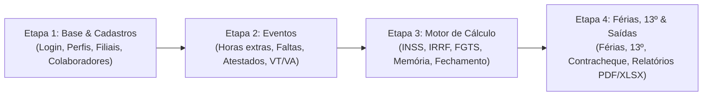

# Sistema de RH e Folha de Pagamento

> **Projeto acadêmico e prático de Gestão de Tecnologia da Informação (GTI)**  
> **Especificação:** GTI 4º período · **Desenvolvimento:** GTI 2º período  
> **Cliente:** Correspondente bancário (15 colaboradores, 1 matriz + 2 filiais)  
> **Versão da Especificação:** 1.0 consolidada (14/10/2026)

---

## 📌 Visão Geral do Projeto

Este repositório contém a documentação e o código-fonte do **Sistema de RH e Folha de Pagamento**, projetado para automatizar e organizar o cálculo da folha mensal, férias, 13º salário, horas extras, adicionais e benefícios de uma instituição de correspondente bancário.

O sistema foi concebido com foco em segurança, rastreabilidade (auditoria), conformidade com a LGPD e rigor no cálculo financeiro, garantindo parametrização legal e memória de cálculo detalhada para cada verba processada.

---

## 👥 Equipe e Responsáveis

### GTI 4º Período (Requisitos, Negócio e Qualidade)
- **Severino Felipe:** Líder e ponte de comunicação com o 2º período
- **Antônio Fabrício:** Regras de negócio e engenharia de folha
- **José Roberto:** Contato direto com o cliente (RH) e atas
- **Wesley Antônio:** Estratégia de testes e garantia de qualidade

### GTI 2º Período (Desenvolvimento)
- **Kauã:** Representante do grupo / Repositório, INSS, IRRF e ponte com o 4º período
- **Jeremias:** Desenvolvedor e Vibe Coder
- **Valdir:** Desenvolvedor responsável por correções
- **Pietro:** Desenvolvedor Back-end (Back-end Developer) / AI Quality Engineer

### Grupo de RH (Cliente)
- **Vitor:** Diretor de Recursos Humanos
- **Deyse:** Analista de Departamento Pessoal (folha, férias, 13º, benefícios)
- **Alana Catiany de Morais:** Analista de Recrutamento e Seleção
- **Marília:** Analista de Treinamento e Desenvolvimento
- **Thayane:** Analista de Gestão e Relatórios

---

## 🎯 Escopo e Fases de Entrega

O desenvolvimento está dividido em 4 etapas bem delimitadas com critérios de aceite claros:



| Etapa | Entregáveis | Critério de Conclusão |
| :---: | :--- | :--- |
| **Etapa 1** | Autenticação, controle de perfis (RH, Diretoria, Admin), cadastro de filiais e colaboradores | Cadastra, edita, consulta e inativa; rejeita duplicidade de CPF |
| **Etapa 2** | Lançamento mensal de eventos operacionais (horas extras 50%/100%, faltas, atestados médicos, VT e VA) | Validações e cenários de eventos passam |
| **Etapa 3** | Motor de cálculo progressivo (INSS, IRRF com deduções e Lei 15.270/2025, FGTS), memória de cálculo e fechamento seguro de competência | Folha calculada com memória passo a passo; fechamento bloqueado se houver pendências cadastrais |
| **Etapa 4** | Módulo de férias (controle de aquisitivo/concessivo, abono), cálculo do 13º em duas parcelas, emissão de contracheques e relatórios | Cenários de férias e 13º aprovados; relatórios exportáveis em PDF e Excel |

### 🚫 Fora do Escopo da 1ª Versão
Ponto eletrônico biométrico, banco de horas (horas extras são sempre remuneradas), rescisão contratual, arquivo bancário automatizado (CNAB), recrutamento, avaliação de desempenho, portal do colaborador e integrações externas (eSocial, Google, M365).

---

## 🏛️ Diretrizes Arquiteturais e Boas Práticas

1. **Dinheiro é Decimal:** Jamais utilizar tipos de ponto flutuante (`float`, `double`) para valores monetários. Utilizar tipos decimais com precisão fixa (`DECIMAL(12,2)` ou bibliotecas de precisão monetária) para evitar erros de centavos.
2. **Parametrização por Vigência:** Alíquotas e faixas legais de INSS, IRRF, salário mínimo e adicionais nunca devem ser fixados no código-fonte (*hardcoded*). Devem residir em tabelas de parâmetros com data de início e fim de vigência.
3. **Memória de Cálculo Completa:** Toda verba calculada deve registrar os parâmetros aplicados, bases de cálculo e regra de arredondamento adotada.
4. **Segurança e LGPD:** Criptografia de senhas com algoritmo seguro (hash + salt), criptografia em repouso de dados sensíveis e de saúde (atestados médicos), e auditoria completa de alterações (*logs* imutáveis).
5. **Regra de Ouro:** Se faltar informação ou houver ambiguidade, **não invente regras de negócio**. Consulte [docs/perguntas-pendentes.md](docs/perguntas-pendentes.md) e reporte à equipe do GTI 4º período.

---

## 💻 Executando o Backend (API Flask)

O backend do sistema está localizado na pasta [`backend/`](backend/) e foi desenvolvido em **Python + Flask + SQLite**.

### 1. Pré-requisitos
* Python 3.10 ou superior instalado.

### 2. Configuração e Inicialização
```bash
# Acesse o diretório do backend
cd backend

# Crie e ative o ambiente virtual
python -m venv venv
# No Windows:
venv\Scripts\activate
# No Linux/Mac:
# source venv/bin/activate

# Instale as dependências
pip install -r requirements.txt

# Inicialize o banco de dados SQLite com os parâmetros legais de 2026
python manage.py init-db

# Crie o primeiro usuário administrador ou de RH
python manage.py criar-usuario --nome "Maria" --email maria@empresa.com --perfil RH

# (Opcional) Popule filiais e colaboradores fictícios de teste
python manage.py seed-demo

# Inicie o servidor da API (porta 5000)
python run.py
```

### 3. Executando os Testes Automatizados
```bash
# Na pasta backend, execute:
python -m unittest discover -s tests -t . -v
```
Todos os 34 testes unitários e de integração devem passar com sucesso.

---

## 📂 Estrutura de Documentação

- [docs/especificacao-requisitos.md](docs/especificacao-requisitos.md): Documento oficial e integral de especificação de requisitos (v1.0 consolidada).
- [docs/uso-de-ia.md](docs/uso-de-ia.md): Guia de trabalho com IA, incluindo os 5 prompts padronizados e regras de conduta.
- [docs/perguntas-pendentes.md](docs/perguntas-pendentes.md): Rastreamento de dúvidas, hipóteses não confirmadas e pendências junto ao cliente e contabilidade.
- [AGENTS.md](AGENTS.md): Diretrizes operacionais e restrições obrigatórias para agentes e assistentes de inteligência artificial.

---

## 🚀 Como Contribuir

1. Leia integralmente o arquivo [docs/especificacao-requisitos.md](docs/especificacao-requisitos.md).
2. Certifique-se de que cada alteração implemente testes unitários com base nos cenários de aceite em Gherkin.
3. Ao usar IA, siga estritamente os comandos e premissas detalhados em [docs/uso-de-ia.md](docs/uso-de-ia.md).
