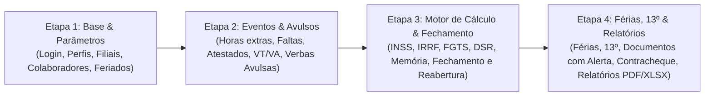

# Sistema de RH e Folha de Pagamento

> **Projeto acadêmico e prático de Gestão de Tecnologia da Informação (GTI)**  
> **Especificação:** GTI 4º período · **Desenvolvimento:** GTI 2º período  
> **Cliente:** Correspondente bancário (15 colaboradores, 1 matriz + 2 filiais)  
> **Versão da Especificação:** 1.3 (21/10/2026)

---

## 📌 Visão Geral do Projeto

Este repositório contém a documentação e o código-fonte do **Sistema de RH e Folha de Pagamento**, projetado para automatizar e organizar o cálculo da folha mensal, férias, 13º salário, horas extras, adicionais e benefícios de uma instituição de correspondente bancário.

O sistema foi concebido com foco em segurança, rastreabilidade (auditoria), conformidade com a LGPD e rigor no cálculo financeiro, garantindo parametrização legal e memória de cálculo detalhada para cada verba processada.

---

## 👥 Equipe e Responsáveis

### GTI 4º Período (Requisitos, Negócio e Qualidade)
- **Severino Felipe:** Líder e ponte com o 2º período
- **Antônio Fabrício:** Regras de negócio e folha
- **José Roberto:** Contato com o cliente (RH) e ata
- **Wesley Antônio:** Testes e qualidade

### GTI 2º Período (Desenvolvimento)
- **Jonas Kauã:** Representante da turma e desenvolvedor
- **Carlos Pietro:** Desenvolvedor
- **José Geremias:** Desenvolvedor
- **Valdir Fonséca:** Desenvolvedor

### Grupo de RH (Cliente)
- **Vitor:** Diretor de Recursos Humanos: coordena a equipe, acompanha resultados e supervisiona as atividades
- **Deyse:** Analista de Departamento Pessoal: folha, férias, 13º, benefícios e documentos
- **Alana Catiany de Morais:** Analista de Recrutamento e Seleção. Passou as informações ao GTI
- **Marília:** Analista de Treinamento e Desenvolvimento
- **Thayane:** Analista de Gestão e Relatórios: organiza dados, controla planilhas e elabora relatórios

---

## 🎯 Escopo e Fases de Entrega

> **Diretriz oficial (v1.3):** O repositório segue a especificação v1.3, implementando as regras oficiais de DSR (RN-31), reflexos de horas extras (RN-32 e RN-48), 13º salário (RN-46 e RN-48) e verbas avulsas (RN-25).

| Etapa | Entregáveis | Critério de Conclusão |
| :---: | :--- | :--- |
| **Etapa 1** | Autenticação, controle de perfis (RH, Diretoria, Admin), cadastro de filiais, colaboradores, parâmetros legais e feriados | Cadastra, edita, consulta e inativa; rejeita duplicidade de CPF e valida campos obrigatórios |
| **Etapa 2** | Lançamento mensal de eventos (horas extras 50%/100%, faltas, atestados médicos, VT, VA e verbas avulsas RN-25) | Cenários de horas extras e descontos passam. A tela de lançamentos com verbas avulsas precisa estar pronta antes do cálculo da Etapa 3 |
| **Etapa 3** | Motor de cálculo progressivo (INSS, IRRF com redução da Lei 15.270/2025, FGTS, DSR RN-31), memória de cálculo detalhada, fechamento seguro e reabertura com log | Folha calculada com memória passo a passo; fechamento bloqueado nos casos da tabela 7.1; reabertura com justificativa e notificação à diretoria |
| **Etapa 4** | Módulo de férias (aquisitivo/concessivo, abono, redução por faltas, média de variáveis), 13º em 2 parcelas, documentos com alerta, contracheques e relatórios | Cenários de férias e 13º aprovados; emissão de contracheque e relatórios exportáveis em PDF e Excel |

### 🚫 Fora do Escopo da 1ª Versão
- **Processos e Ferramentas:** Ponto eletrônico biométrico, banco de horas (horas extras são sempre remuneradas), rescisão contratual, arquivo bancário automatizado (CNAB), recrutamento e seleção, avaliação de desempenho/treinamentos, portal do colaborador e integrações externas automáticas (eSocial, Microsoft 365, Google).
- **Sem Cálculo Automático (Lançados como Verbas Avulsas - RN-25):** Adicional noturno, insalubridade, periculosidade, comissões, salário-família, pensão alimentícia, empréstimo consignado e assistência médica. O RH registra esses itens manualmente com as devidas incidências de INSS, IRRF e FGTS.

---

## 🛠️ Stack Tecnológica Definida (Seção 15.3)

- **Linguagem & Runtime:** Node.js com TypeScript
- **Banco de Dados Relacional:** PostgreSQL (tipos `DECIMAL(12, 2)` para valores monetários)
- **Precisão Financeira:** Biblioteca `decimal.js` (arredondamento *half-up* por verba - RN-03)
- **Testes Automatizados:** Testes unitários e de integração cobrindo 100% dos cenários Gherkin (Seção 10) e exemplos numéricos oficiais (Seção 8)

---

## 🏛️ Diretrizes Arquiteturais e Boas Práticas

1. **Dinheiro é Decimal:** Jamais utilizar tipos de ponto flutuante (`float`, `double`) para valores monetários. Utilizar tipos decimais com precisão fixa (`DECIMAL(12,2)` ou bibliotecas de precisão monetária) para evitar erros de centavos.
2. **Parametrização por Vigência:** Alíquotas e faixas legais de INSS, IRRF, salário mínimo e adicionais nunca devem ser fixados no código-fonte (*hardcoded*). Devem residir em tabelas de parâmetros com data de início e fim de vigência.
3. **Memória de Cálculo Completa:** Toda verba calculada deve registrar os parâmetros aplicados, bases de cálculo e regra de arredondamento adotada.
4. **Segurança e LGPD:** Criptografia de senhas com algoritmo seguro (hash + salt), criptografia em repouso de dados sensíveis e de saúde (atestados médicos), e auditoria completa de alterações (*logs* imutáveis).
5. **Regra de Ouro:** Se faltar informação ou houver ambiguidade, **não invente regras de negócio**. Consulte [docs/perguntas-pendentes.md](docs/perguntas-pendentes.md) e reporte à equipe do GTI 4º período.

---

## 📂 Estrutura de Documentação

- [docs/spec.md](docs/spec.md): Documento oficial e integral de especificação de requisitos (v1.3).
- [docs/uso-de-ia.md](docs/uso-de-ia.md): Guia de trabalho com IA, incluindo os 5 prompts padronizados e regras de conduta.
- [docs/perguntas-pendentes.md](docs/perguntas-pendentes.md): Rastreamento de dúvidas, hipóteses não confirmadas e pendências junto ao cliente e contabilidade.
- [AGENTS.md](AGENTS.md): Diretrizes operacionais e restrições obrigatórias para agentes e assistentes de inteligência artificial.

---

## 🚀 Como Contribuir

1. Leia integralmente o arquivo [docs/spec.md](docs/spec.md).
2. Certifique-se de que cada alteração implemente testes unitários com base nos cenários de aceite em Gherkin.
3. Ao usar IA, siga estritamente os comandos e premissas detalhados em [docs/uso-de-ia.md](docs/uso-de-ia.md).
